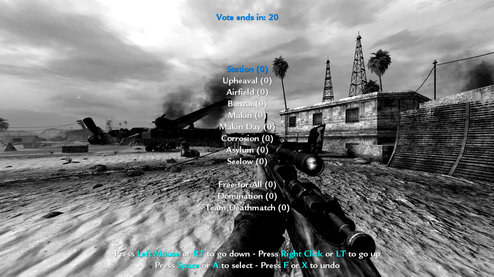

# Mapvote

A customizable mapvote script for both multiplayer and zombies.  

**It does support custom maps in zombies, but for dedicated servers only**

This is heavily inspired by [LastDemon99's IW5 mapvote](https://github.com/LastDemon99/IW5_VoteSystem).  
I also re-used some code from [DoktorSAS's T6 mapvote](https://github.com/DoktorSAS/PlutoniumT6Mapvote) and studied [ShepFX's T4 mapvote](https://github.com/ShepFX/PlutoniumT4Mapvote) for the zombies game end handling.  
Huge thanks to them.

## AI Disclaimer

It's a port of [my BO2 (T6) mapvote](https://github.com/Resxt/Plutonium-T6-Scripts/tree/main/mapvote) that I made using AI to greatly accelerate the process and help me find how to alter the game's end game sequence



## mapvote.gsc

This script can be installed in any folder depending on what you want to do.  
The recommended solution is to just install it in the `scripts` folder so that it will work out of the box for both multiplayer and zombies.  

**[IMPORTANT]** Installing `mapvote_mp_extend.gsc` in `scripts\mp` is **mandatory** to make the mapvote work normally in multiplayer.  
**[IMPORTANT]** Installing `mapvote_zm_extend.gsc` in `scripts\sp` is **mandatory** to make the mapvote work normally in zombies.  

### Main features

- It allows up to 12 elements (maps + modes) to be displayed on screen
- You can configure how much maps and modes you want on screen
- It will automatically adapt the amount of elements to display if you don't choose a fixed amount of maps/modes to show
- It has separate map and mode choices for multiplayer
- It supports custom gametype names in multiplayer and custom map names in zombies
- It supports custom zombies maps on dedicated servers
- It rotates a random map from the list when there are no votes for maps. Same applies for modes in multiplayer too
- You can choose to rotate a random map and mode from a list you define when the human players count is between a min and max values you define (disabled by default)
- Controllers are fully supported and work out of the box
- It has a good level of customization
- It has a debug mode to quickly preview the menu

### Getting started

To configure the menu before deploying I recommend running it in a custom game with the `mapvote_debug` dvar set to `1`.  
To do that use this command in the console `set mapvote_debug 1` before running a custom game.  
Start a custom game and you will see the menu.  
You can then configure the dvars directly in your console and restart the map with `map_restart` in the console to edit the menu quickly and get your perfect setup.

Note that by default the mapvote will be activated on all of your servers.  
If you run multiple servers and want it off on certain servers you will need to add `set mapvote_enable 0` in the server's CFG.

### Configuration

Below is an example CFG showing how each dvar can be configured.  
The values you see are the default values that will be used if you don't set a dvar.  

<details>
  <summary>Multiplayer CFG</summary>

  ```c
set mapvote_enable 1
set mapvote_maps "Airfield:Asylum:Banzai:Battery:Breach:Castle:Cliffside:Corrosion:Courtyard:Dome:Downfall:Hangar:Knee Deep:Makin:Makin Day:Nightfire:Outskirts:Revolution:Roundhouse:Seelow:Station:Sub Pens:Upheaval" // Default value: every map
set mapvote_modes "Team Deathmatch,tdm:Free-for-All,dm:Domination,dom" // Default value: Team Deathmatch, Free-for-All and Domination
set mapvote_limits_maps 0
set mapvote_limits_modes 0
set mapvote_limits_max 12
set mapvote_colors_selected "blue"
set mapvote_colors_unselected "white"
set mapvote_colors_timer "blue"
set mapvote_colors_timer_low "red"
set mapvote_colors_help_text "white"
set mapvote_colors_help_accent "cyan"
set mapvote_colors_help_accent_mode "standard"
set mapvote_sounds_menu_enabled 1
set mapvote_sounds_timer_enabled 1
set mapvote_vote_time 30
set mapvote_blur_level 2.5
set mapvote_blur_fade_in_time 2
set mapvote_horizontal_spacing 75
set mapvote_display_wait_time 7
set mapvote_default_rotation_enable 0
set mapvote_default_rotation_maps "Airfield:Dome:Castle:Roundhouse:Seelow"
set mapvote_default_rotation_modes "tdm"
set mapvote_default_rotation_min_players 0
set mapvote_default_rotation_max_players 0
```

Here are some pre-set values if you want to quickly copy/paste something

| Description | Value |
|---|---|
| All stock maps | "Airfield:Asylum:Banzai:Battery:Breach:Castle:Cliffside:Corrosion:Courtyard:Dome:Downfall:Hangar:Knee Deep:Makin:Makin Day:Nightfire:Outskirts:Revolution:Roundhouse:Seelow:Station:Sub Pens:Upheaval" |
| Classic modes | "Team Deathmatch,tdm:Free-for-All,dm:Domination,dom:Search & Destroy,sd:Capture the Flag,ctf:Headquarters,hq:Sabotage,sab:War,twar" |
| FFA 24/7 | "Free-for-All,dm" |
| SND 24/7 | "Search & Destroy,sd" |

</details>

<details>
  <summary>Zombies CFG</summary>

  ```c
set mapvote_enable 1
set mapvote_maps "Nacht der Untoten,Nacht der Untoten,nazi_zombie_prototype:Verruckt,Verruckt,nazi_zombie_asylum:Shi No Numa,Shi No Numa,nazi_zombie_sumpf:Der Riese,Der Riese,nazi_zombie_factory" // Default value: all stock maps
set mapvote_custom_maps ""
set mapvote_limits_max 12
set mapvote_colors_selected "blue"
set mapvote_colors_unselected "white"
set mapvote_colors_timer "blue"
set mapvote_colors_timer_low "red"
set mapvote_colors_help_text "white"
set mapvote_colors_help_accent "cyan"
set mapvote_colors_help_accent_mode "standard"
set mapvote_sounds_menu_enabled 1
set mapvote_sounds_timer_enabled 1
set mapvote_vote_time 30
set mapvote_blur_level 2.5
set mapvote_blur_fade_in_time 2
set mapvote_horizontal_spacing 75
set mapvote_display_wait_time 7
set mapvote_default_rotation_enable 0
set mapvote_default_rotation_maps "Der Riese,Der Riese,nazi_zombie_factory"
set mapvote_default_rotation_min_players 0
set mapvote_default_rotation_max_players 0
```

Here are some pre-set values if you want to quickly copy/paste something

| Description | Value |
|---|---|
| All stock maps | "Nacht der Untoten,Nacht der Untoten,nazi_zombie_prototype:Verruckt,Verruckt,nazi_zombie_asylum:Shi No Numa,Shi No Numa,nazi_zombie_sumpf:Der Riese,Der Riese,nazi_zombie_factory" |
| Custom maps (dedicated servers only) | `mapvote_custom_maps "Minecraft Village,minecraft_village,nazi_zombie_fear_mc_2"` |

</details>

### Dvars

Here are the dvars you can configure:

<details>
  <summary>Multiplayer dvars</summary>
  
| Name | Description | Accepted values |
|---|---|---|
| mapvote_enable | Toggle whether the mapvote is activated or not. 0 is off and 1 is on | 0 or 1 |
| mapvote_debug | Toggle whether the mapvote runs in debug mode or not. This will display the mapvote menu a few seconds after starting the game. 0 is off and 1 is on | 0 or 1 |
| mapvote_maps | A list of the maps that are available for rotation | Any stock map display name. Each map is separated with a colon (:) |
| mapvote_modes | A list of the modes that are available for rotation. The first parameter is how the mode will be displayed, it can be set to anything you like, the second parameter is the gametype short name used for the rotation | Any text followed by a comma (,) and then a gametype short name (`tdm`, `dm`, `dom`, `sd`, `ctf`, `hq`, `sab`, `twar`). Each block is separated with a colon (:) |
| mapvote_limits_maps | The amount of maps to display. 0 will handle it automatically | Any plain number from 0 to `mapvote_limits_max` |
| mapvote_limits_modes | The amount of modes to display. 0 will handle it automatically | Any plain number from 0 to `mapvote_limits_max` |
| mapvote_limits_max | The maximum amount of elements to display (maps + modes) | 2, 4, 6, 8, 10, 12 |
| mapvote_colors_selected | The color of the text when hovered or selected. This is also the color of the votes count | red, green, yellow, blue, cyan, purple, white, grey, gray, black |
| mapvote_colors_unselected | The color of the text when not hovered and not selected | red, green, yellow, blue, cyan, purple, white, grey, gray, black |
| mapvote_colors_timer | The color of the timer as long as it has more than 5 seconds remaining | red, green, yellow, blue, cyan, purple, white, grey, gray, black |
| mapvote_colors_timer_low | The color of the timer when it has 5 or less seconds remaining | red, green, yellow, blue, cyan, purple, white, grey, gray, black |
| mapvote_colors_help_text | The color of the help text at the bottom explaining how to use the menu | red, green, yellow, blue, cyan, purple, white, grey, gray, black |
| mapvote_colors_help_accent | The color of the accented text of the help text at the bottom | red, green, yellow, blue, cyan, purple, white, grey, gray, black |
| mapvote_colors_help_accent_mode | The accenting mode for the help text. `standard` only puts the accent color on the button to press and `max` puts it on both the buttons and the action it does | standard or max |
| mapvote_sounds_menu_enabled | Toggle whether the mapvote menu sounds are enabled or not. 0 is off and 1 is on | 0 or 1 |
| mapvote_sounds_timer_enabled | Toggle whether the timer will start making a beeping sound every second when there's 5 or less seconds remaining to vote or not. 0 is off and 1 is on | 0 or 1 |
| mapvote_vote_time | The time the vote lasts (in seconds) | Any plain number above 5 |
| mapvote_blur_level | The amount of blur to put when the mapvote menu starts to show. The max recommended value is 5. 0 disables it | Any number |
| mapvote_blur_fade_in_time | The time (in seconds) it takes for the blur to reach `mapvote_blur_level`. For example if you set it to 10 and `mapvote_blur_level` is 5 then it will progressively blur the screen from 0 to 5 in 10 seconds | Any number |
| mapvote_horizontal_spacing | The horizontal spacing between the map/mode names and the vote counts. I recommend setting this value according to the longest map or mode name length so that it doesn't overlap with the vote counts | Any plain number |
| mapvote_display_wait_time | The time (in seconds) the win screen stays on screen before the mapvote replaces it | Any number superior or equal to 0.05 |
| mapvote_default_rotation_enable | Toggle whether the default rotation system is activated or not. This allows you to have one or more map(s) and mode(s) rotate by default when the human player count is between `mapvote_default_rotation_min_players` and `mapvote_default_rotation_max_players` (inclusive). 0 is off and 1 is on | 0 or 1 |
| mapvote_default_rotation_maps | A list of the maps that are available for default rotation | Any stock map display name. Each map is separated with a colon (:) |
| mapvote_default_rotation_modes | A list of the modes that are available for default rotation | Any gametype short name. Each one is separated with a colon (:) |
| mapvote_default_rotation_min_players | The minimum amount of human players required to rotate the default rotation instead of showing the mapvote. If the human players count is smaller than this then it will display the mapvote | Any plain number from 0 to 18 |
| mapvote_default_rotation_max_players | The maximum amount of human players required to rotate the default rotation instead of showing the mapvote. If the human players count is higher than this then it will display the mapvote | Any plain number from 0 to 18 |
  
</details>

<details>
  <summary>Zombies dvars</summary>
  
| Name | Description | Accepted values |
|---|---|---|
| mapvote_enable | Toggle whether the mapvote is activated or not. 0 is off and 1 is on | 0 or 1 |
| mapvote_debug | Toggle whether the mapvote runs in debug mode or not. This will display the mapvote menu a few seconds after starting the game. 0 is off and 1 is on | 0 or 1 |
| mapvote_maps | A list of the maps that are available for rotation, including how you want to display it | The display name followed by a comma (,), then the map name, then another comma (,) and a cfg field (present but unused). Each block is separated with a colon (:) |
| mapvote_custom_maps | A list of the custom maps that are available for rotation, in addition to the ones from `mapvote_maps`. The first parameter is how the map will be displayed, the second parameter is the mod's folder name (the folder inside the `mods` folder of your Plutonium storage) and the third parameter is the map's name. Custom maps are only available on dedicated servers | Any text followed by a comma (,), then the mod's folder name, then another comma (,) and the map's name (e.g. `Minecraft Village,minecraft_village,nazi_zombie_fear_mc_2`). Each block is separated with a colon (:) |
| mapvote_limits_max | The maximum amount of maps to display | Any plain number from 2 to 12 |
| mapvote_colors_selected | The color of the text when hovered or selected. This is also the color of the votes count | red, green, yellow, blue, cyan, purple, white, grey, gray, black |
| mapvote_colors_unselected | The color of the text when not hovered and not selected | red, green, yellow, blue, cyan, purple, white, grey, gray, black |
| mapvote_colors_timer | The color of the timer as long as it has more than 5 seconds remaining | red, green, yellow, blue, cyan, purple, white, grey, gray, black |
| mapvote_colors_timer_low | The color of the timer when it has 5 or less seconds remaining | red, green, yellow, blue, cyan, purple, white, grey, gray, black |
| mapvote_colors_help_text | The color of the help text at the bottom explaining how to use the menu | red, green, yellow, blue, cyan, purple, white, grey, gray, black |
| mapvote_colors_help_accent | The color of the accented text of the help text at the bottom | red, green, yellow, blue, cyan, purple, white, grey, gray, black |
| mapvote_colors_help_accent_mode | The accenting mode for the help text. `standard` only puts the accent color on the button to press and `max` puts it on both the buttons and the action it does | standard or max |
| mapvote_sounds_menu_enabled | Toggle whether the mapvote menu sounds are enabled or not. 0 is off and 1 is on | 0 or 1 |
| mapvote_sounds_timer_enabled | Toggle whether the timer will start making a beeping sound every second when there's 5 or less seconds remaining to vote or not. 0 is off and 1 is on | 0 or 1 |
| mapvote_vote_time | The time the vote lasts (in seconds) | Any plain number above 5 |
| mapvote_blur_level | The amount of blur to put when the mapvote menu starts to show. The max recommended value is 5. 0 disables it | Any number |
| mapvote_blur_fade_in_time | The time (in seconds) it takes for the blur to reach `mapvote_blur_level`. For example if you set it to 10 and `mapvote_blur_level` is 5 then it will progressively blur the screen from 0 to 5 in 10 seconds | Any number |
| mapvote_horizontal_spacing | The horizontal spacing between the map names and the vote counts. I recommend setting this value according to the longest map name length so that it doesn't overlap with the vote counts | Any plain number |
| mapvote_display_wait_time | Once the last player dies, the time to wait before displaying the vote menu (in seconds) | Any number superior or equal to 0.05 |
| mapvote_default_rotation_enable | Toggle whether the default rotation system is activated or not. This allows you to have one or more map(s) and mode(s) rotate by default when the human player count is between `mapvote_default_rotation_min_players` and `mapvote_default_rotation_max_players` (inclusive). 0 is off and 1 is on | 0 or 1 |
| mapvote_default_rotation_maps | A list of the maps that are available for default rotation | The display name followed by a comma (,), then the map name, then another comma (,) and a cfg field (present but unused). Each block is separated with a colon (:) |
| mapvote_default_rotation_min_players | The minimum amount of human players required to rotate the default rotation instead of showing the mapvote. If the human players count is smaller than this then it will display the mapvote | Any plain number from 0 to 4 |
| mapvote_default_rotation_max_players | The maximum amount of human players required to rotate the default rotation instead of showing the mapvote. If the human players count is higher than this then it will display the mapvote | Any plain number from 0 to 4 |
  
</details>

### Notes

- If right click is set to toggle ads then pressing right click will make the player go up by one every 0.25s until he right clicks again.  
If I didn't change it to be that way players with toggle ads would have to press right click twice to go up by one all the time.  
Now instead they simply right click once to start going up and right click again to stop which is a better user experience.
- When there's only one map/mode, instead of showing a single vote possibility, your single map/mode will be hidden to make the user experience better but it will still always rotate to your one map/mode
- WaW HUD elements have a hardcoded limit of 16 per client and the mapvote needs up to 15 of them (12 elements + timer + 2 help lines).  
If some map/mode names or vote counts don't display at all then you probably have other scripts that create HUD elements and there's too much elements to display so either remove your script or lower `mapvote_limits_max` so that the mapvote will display less elements
- When two maps/modes have the same votes, the lowest one in the list will win. In the future it would be nice to randomize between both
- Multiplayer custom maps are only supported if their display name exists in `mapvote.gsc`'s `GetMapCodeName` function. Adding your own map is just adding a new case there
- Custom maps support is not added in solo/custom games because Plutonium cannot load a mod while in-game

## mapvote_mp_extend.gsc

A small script that goes with `mapvote.gsc` to make it work in multiplayer.  
It has to be installed in the `scripts\mp` directory since it contains multiplayer only code.  
Putting it in `scripts` or `scripts\sp` will throw an error when booting up a zombies map.

## mapvote_zm_extend.gsc

A small script that goes with `mapvote.gsc` to make it work in zombies.  
It has to be installed in the `scripts\sp` directory since it contains zombies only code.  
Putting it in `scripts` or `scripts\mp` will throw an error when booting up a multiplayer map.